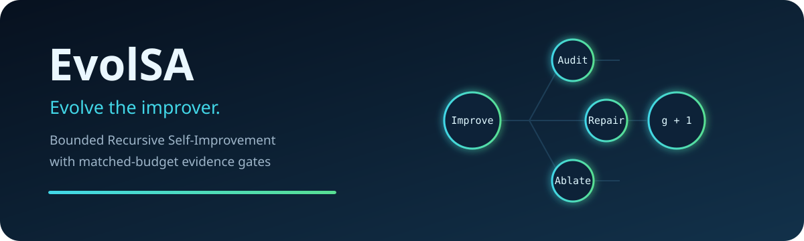
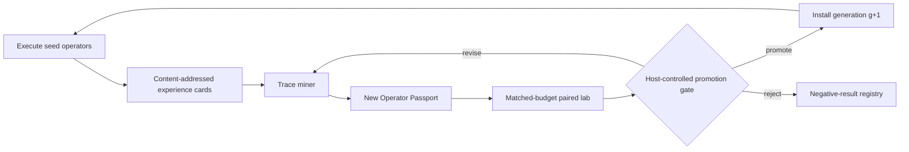

<div align="center">
  
</div>

<div align="center">
  <strong>A model-agnostic operator foundry and evidence gate for bounded Recursive Self-Improvement</strong><br>
  Evolve the improver, not just the answer.
</div>

<p align="center">
  <a href="README.zh-CN.md">中文</a> ·
  <a href="docs/architecture.md">Architecture</a> ·
  <a href="docs/concepts/bounded-rsi.md">Bounded RSI</a> ·
  <a href="docs/concepts/operator-genome.md">Operator genome</a> ·
  <a href="docs/concepts/promotion-protocol.md">Promotion protocol</a> ·
  <a href="SECURITY.md">Security</a>
</p>

---

EvolSA is an executable research framework for **Recursive Self-Improvement (RSI)** in
**self-improving LLM agents**, **self-evolving agents**, and other **agentic AI** systems.
Instead of letting an agent rewrite arbitrary parts of itself, EvolSA turns *how improvement
is done* into a bounded, versioned, testable object:

```text
G₍g₎ = (operators, scheduler, memory policy)
```

The task artifact evolves in an inner loop. An outer loop mines execution traces, compiles a
new Operator Passport, evaluates it against a baseline under matched budgets, and installs it
only when evaluator evidence clears the configured promotion gate.

> **Research preview:** EvolSA is a local, dependency-free reference lab. Its subprocess
> backend is not a security boundary; untrusted code requires a real container or VM adapter.
> The project studies bounded, evidence-gated RSI and does not claim general or autonomous RSI.

### v0.1 trust and release boundary

- Local content addresses and the event hash chain provide integrity checks and make later
  mutation detectable; they do **not** authenticate the producer. A production deployment must
  sign each run root from an external identity and retain it in an external storage domain.
- “Sealed” means excluded from foundry prompts and selection feedback during the declared
  protocol. Task packs shipped in this public repository are public and are not secrets.
- Python callbacks, `TaskAdapter` implementations, model backends, and other adapters running
  in the main process are trusted code in v0.1. Do not load untrusted implementations there.
- `SubprocessSandbox` constrains only a child command. It does not isolate the main search
  process and does not provide filesystem or network isolation; production use requires a
  separately configured hardened container or VM.
- The local registry can persist and restore only callback-free, content-addressed L0
  `prompt_template` operators. In-process callbacks and adapter implementations are not
  serialized or restored across process restarts.
- Production use additionally requires an evaluator outside the agent/search process, hardened
  execution isolation, and an externally signed run root. The offline demo supplies none of
  those production trust anchors.

## The differentiating loop



Generating a better final artifact is not sufficient RSI evidence. EvolSA requires a change to
the improvement process itself, transfer to held-out tasks, and a higher improvement rate per
unit budget.

## Five-minute offline demo

Python 3.11+ is the only requirement. The demo uses a deterministic local backend and makes
no network request.

```bash
python3 -m venv .venv
source .venv/bin/activate
python -m pip install -e .

evolsa demo --output .evolsa/demo
evolsa inspect .evolsa/demo
```

The demo:

1. runs Draft, Improve, Debug, and Crossover on a small evaluator-backed task pack;
2. stores content-addressed artifacts and hash-chained execution events;
3. identifies a repeated high-lift transformation represented by the configured trace tags;
4. compiles that bounded pattern into a new L0 prompt-template Operator Passport;
5. executes both the real `Improve@1.0.0` baseline and candidate from the same evaluated parent
   on promotion tasks with identical model, sampling, and budget conditions;
6. promotes, rejects, or quarantines the operator through the configured host-side gate;
7. reloads the installed operator into `SearchEngine` and compares sealed G0/G1 trajectories
   with the same task, seed, evaluator, model, and total search budget, changing only plan step 0;
8. writes per-step best-utility/usage receipts, JSON evidence, a Markdown review, and a
   self-contained lineage report.

The paired and sealed receipts separately account for model-generation calls. The canonical
`ImproveOperator` and the evolved operator each execute through the same `ModelBackend`; a
passport-sharing demo wrapper cannot stand in for the baseline implementation.

## Three operating modes

| Mode | Evolves task artifacts | Proposes trace-derived operators | Installs operators |
|---|---:|---:|---:|
| Library | — | — | imports stable passports only |
| Search | yes | — | — |
| RSI | yes | yes | only after matched-budget promotion |

## Operator Passport

An operator is not a loose prompt. It declares where it applies, what it may change, its
budget, lineage, baseline, guardrails, and failure modes:

```json
{
  "api_version": "evolsa/v1",
  "name": "normalize-punctuation",
  "version": "0.1.0",
  "intent": "repair classification errors caused by punctuation variants",
  "parents": ["improve@1.0.0"],
  "preconditions": ["punctuation_errors_observed"],
  "expected_effects": ["task_artifact"],
  "forbidden_effects": ["evaluator", "sandbox", "promotion_gate", "event_log"],
  "verification": {
    "baseline": "improve@1.0.0",
    "primary_metric": "paired_lift",
    "minimum_tasks": 4
  }
}
```

## Architecture

| Module | Responsibility |
|---|---|
| `evolsa.sdk` | model-independent TaskAdapter, Operator, and ModelBackend protocols |
| `evolsa.kernel` | budgets, content-addressed artifacts, hash-chained events, sandbox adapters, trust checks |
| `evolsa.operators` | Draft, Improve, Debug, and Crossover bootstrap instruction set |
| `evolsa.memory` | deterministic Experience Cards/Board and operator-conditioned retrieval |
| `evolsa.search` | DAG plus quality/progress/novelty scheduling under finite budgets |
| `evolsa.foundry` | trace mining and L0 Operator Passport synthesis |
| `evolsa.lab` | paired statistics, bootstrap intervals, and fail-closed promotion |
| `evolsa.registry` | versioned lifecycle, evidence binding, installation, and rollback |
| `evolsa.report` | static audit review and visible operator lineage |

An installed evolved operator is added to the next search generation with an explicit capability
binding such as `bind_operation_family(installed, "improve")`. Search never guesses behavior,
parent arity, or retrieval policy from the operator's name.

The conceptual mutable surface is deliberately small: task artifacts, operators, scheduler
parameters, and memory policy. Evaluators, sealed-task allocation, sandbox policy, maximum
budgets, event history, promotion thresholds, signatures, and release permission stay outside
the genome by protocol. In v0.1, only callback-free L0 prompt-template operators are persisted
and restored; scheduler and memory-policy evolution remain roadmap work.

## Research lineage

EvolSA is a from-scratch Apache-2.0 implementation inspired by the execution-grounded operator
and long-horizon search principles in Frontis-MA1/OpenMLE. It targets the limitation explicitly
identified there: candidate programs evolve while the evolutionary system remains largely fixed.
No OpenRSI source code or non-commercial assets are copied into this repository. See
[research foundations](docs/research/foundations.md) and [threat model](docs/threat-model.md).

## Status

Version `0.1.0` focuses on the smallest distinguishable bounded-RSI loop: **trace → passport →
paired evidence → promotion → installation**. See the [roadmap](docs/roadmap.md) before using
research-preview interfaces in production.

## License

Apache-2.0. See [LICENSE](LICENSE) and [NOTICE](NOTICE).
