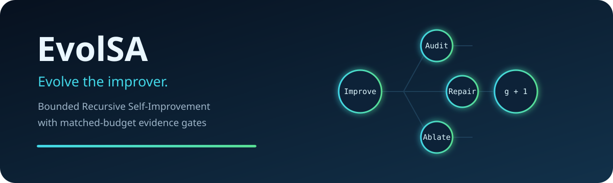

<div align="center">
  
</div>

<div align="center">
  <strong>面向 bounded Recursive Self-Improvement 的模型无关 Operator Foundry 与证据门</strong><br>
  不只进化答案，进化“如何改进”。
</div>

<p align="center">
  <a href="README.md">English</a> ·
  <a href="docs/architecture.md">架构</a> ·
  <a href="docs/concepts/bounded-rsi.md">Bounded RSI</a> ·
  <a href="docs/concepts/operator-genome.md">Operator Genome</a> ·
  <a href="SECURITY.md">安全</a>
</p>

---

EvolSA 是面向 **Recursive Self-Improvement (RSI)**、**self-improving LLM agents**、
**self-evolving agents** 与 **agentic AI** 的可执行研究框架。它不会让 Agent 任意改写
自身代码，而是把“如何改进”表示成一个有边界、可版本化、可验证、可回滚的对象：

```text
G₍g₎ =（操作符集合、调度策略、记忆策略）
```

任务内循环改进产物；元循环从执行轨迹挖掘有边界的策略模式，生成新的 Operator
Passport，再用相同父节点、模型、随机种子和预算做配对实验。只有评测证据通过配置在
宿主侧的晋升门，新操作符才会安装进下一代。

> **研究预览：** 内置 subprocess 后端不是安全隔离边界；执行不可信代码时必须接入
> 容器或 VM。EvolSA 研究的是 bounded、evidence-gated RSI，不宣称已实现通用 RSI。

### v0.1 信任与发布边界

- 本地内容寻址和事件 hash chain 只提供完整性校验并让事后篡改可检测，不提供生产者
  身份认证。生产部署必须用外部身份签署每次运行的根哈希，并保存到外部存储域。
- “sealed”仅表示在声明的实验协议中不进入 Foundry prompt 或选择反馈。公开仓库随附的
 任务包本身是公开信息，不是秘密或保密测试集。
- v0.1 中，运行在主进程内的 Python callbacks、`TaskAdapter`、model backend 和其他
  adapters 都属于可信代码；不得在其中直接加载不可信实现。
- `SubprocessSandbox` 只约束它启动的子进程，不会自动隔离主搜索进程，也不提供文件系统
  或网络隔离。生产环境需要单独配置的强化容器或 VM。
- 本地 registry 只能持久化并在重启后恢复无 callback、内容寻址的 L0
  `prompt_template` operator；进程内 callbacks 与 adapter 实现不会被序列化或恢复。
- 生产使用还需要搜索/Agent 进程外的 evaluator、强化容器或 VM，以及外部签名的运行
  根。离线 demo 不提供这些生产信任锚。

## 离线演示

```bash
python3 -m venv .venv
source .venv/bin/activate
python -m pip install -e .

evolsa demo --output .evolsa/demo
evolsa inspect .evolsa/demo
```

演示会走完整闭环：四个启动操作符 → 内容寻址经验卡 → 受配置 trace tags 约束的模式
归纳 → 新 Passport → 真实 Improve 基线的 matched-budget A/B → 晋升或隔离 → 将已安装
operator 重新接入搜索 → 同任务、seed、模型、评测器和总预算的 sealed G0/G1 配对轨迹 →
Operator 谱系和证据报告。轨迹证据记录每一步累计最佳效用和资源用量；全程无需 API Key
或网络。

## 为什么更接近 RSI

只让最终代码或回答得分变高，是更强搜索，不足以称为 RSI。EvolSA 需要证明：

- 系统从预定义 trace tags 与归纳规则覆盖的模式中合成专用 L0 prompt operator；这不等于
  自主发现任意新技能或人工从未预枚举的策略；
- 变更作用在操作符、调度器或记忆策略，而不仅是任务产物；
- 在未见任务上、匹配预算下，改进速率的置信下界为正；
- 增益能够归因到具体 Operator Passport 和配对证据；
- 评测器、预算、安全阈值与审计日志没有被变更。

## 安全边界

概念上的可进化面：任务产物、操作符、调度参数、记忆检索/压缩策略。v0.1 只支持将
无 callback 的 L0 prompt operator 持久化并在重启后恢复；调度器与记忆策略演化仍在
路线图中。

协议要求受保护：evaluator 与 sealed-test 分配、sandbox 权限、最大预算、事件日志、
晋升阈值、签名和人工发布权限。公开发布的 sealed task 不具备保密性；生产环境必须在
Agent 进程外执行这些控制。安全失败不会被能力分抵消。

EvolSA 由零开始实现并采用 Apache-2.0；仓库不复制 OpenRSI 的非商业许可代码或数据。
详细内容见 [架构](docs/architecture.md)、[晋升协议](docs/concepts/promotion-protocol.md)
和 [威胁模型](docs/threat-model.md)。
