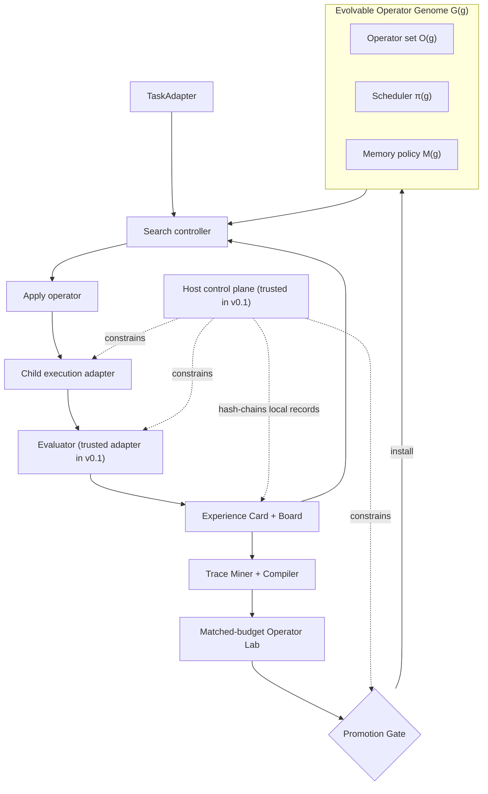

# Architecture

EvolSA separates the evolvable genome from the evidence and control plane. The design follows
the execution-grounded lesson of Frontis-MA1/OpenMLE while making the improver itself a
versioned evaluation target.

## Data flow

1. A `TaskAdapter` materializes a split, seed, evaluator contract, and seed artifact.
2. The controller chooses parent nodes and an operator using quality, progress, novelty, cost,
   and risk signals.
3. The operator receives a bounded, operation-specific evidence view and proposes an artifact.
4. An execution adapter may execute the artifact; the task adapter converts the observation to
   a direction-aware `ScoreCard`. In v0.1 these adapters execute as trusted code in the main
   process unless they explicitly delegate a command to `SubprocessSandbox`.
5. The kernel commits the artifact and a hash-chained event before the controller can reuse it.
6. An `ExperienceCard` captures the node; an `ExperienceBoard` deterministically aggregates
   population state.
7. The foundry matches repeated high-lift or failure-repair evidence to configured trace tags
   and synthesis rules, then compiles the bounded pattern into an L0 prompt-template passport.
8. The lab evaluates candidate and baseline on the same tasks, seeds, parents, and budgets.
9. The gate issues a content-addressed decision. Stable installation is an explicit registry
   operation and can be rolled back.

## Invariants

- Only evaluator output determines task quality; model self-assessment is metadata.
- Local events are append-only by API and hash-chained so later mutation can be detected during
  verification. This is an integrity property, not producer authentication or immutable storage.
- Every installed operator binds to a passport hash, lab report, policy hash, and lineage.
- Protected effects are rejected before execution.
- A capability gain cannot compensate for safety, integrity, or budget failure.
- Sealed tasks do not enter foundry prompts or validation feedback under the protocol. Publicly
  distributed task packs are not secret; “sealed” describes information flow, not confidentiality.

## Extension points

The local reference implementation deliberately keeps `TaskAdapter`, `ModelBackend`,
`Operator`, sandbox execution, artifact storage, and registry persistence behind protocols.
Those interfaces are extension points, not isolation boundaries: Python callbacks and adapters
loaded into the v0.1 process must be trusted. `SubprocessSandbox` constrains only the child it
launches and does not isolate the controller/main search process or provide filesystem/network
isolation.

Installed L0 operators re-enter search through an explicit runtime capability, for example
`bind_operation_family(operator, "improve")`. The scheduler, retriever, and engine never infer
arity or memory policy from a passport name. An evolved operator with no host-supplied family is
rejected before scheduling; the binding is a trusted control-plane decision, not candidate-owned
metadata.

The v0.1 local registry persists and rehydrates only callback-free, content-addressed L0
`prompt_template` operators. Python callbacks, task adapters, and other adapter implementations
are not serializable registry generators and are not restored across a restart.

A production deployment must put the evaluator outside the agent/search process, replace child
execution with a separately configured hardened container/VM boundary, and sign each verified
run root using an external identity with external retention. These controls are not supplied by
the offline reference demo.
